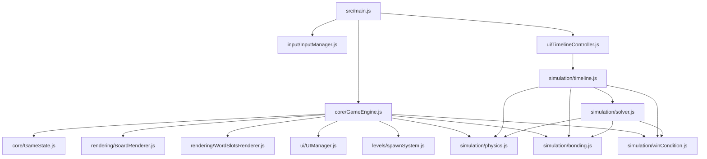

# Tumbleword Architecture Guide

## 1. Monolithic Architecture Problems (Pre-Refactor)
Prior to this refactor, Tumbleword was implemented as a single, 1200+ line monolithic `tumbleword.html` file containing HTML, CSS, DOM operations, simulation math, level data, BFS pathfinding, timeline scrubbing, and state manipulation in a single global scope.

Key architectural problems:
* **Global Scope Contamination**: Game state (`S`), DOM element maps (`cardEls`), history stacks, and solver states were mutable globals prone to race conditions and accidental clobbering.
* **Tightly Coupled Presentation & Physics**: The simulation algorithm directly queried and manipulated DOM styling and classes during calculations.
* **Difficult Level Expansion**: Adding levels required modifying monolithic arrays, coordinate finders, and global constants.
* **No Build Optimization**: Lack of asset bundling, tree-shaking, module dependency graphs, or automated asset pipeline.

---

## 2. Target Architecture Overview

The codebase is organized into clean, single-responsibility ES modules with unidirectional data flow and zero circular dependencies.

```text
E:\PROTO\TUMBLEWORD\
├── index.html                   # HTML Entry Point
├── package.json                 # Project configuration & npm scripts
├── vite.config.js               # Vite build & asset configuration
├── styles/
│   └── main.css                 # Modular styles, CSS custom properties & animations
├── src/
│   ├── main.js                  # Application entry point & subsystem wiring
│   ├── config/
│   │   └── constants.js         # Immutable board dimensions, timings, vectors
│   ├── utils/
│   │   ├── math.js              # Modulo & cloning utilities
│   │   └── storage.js           # LocalStorage persistence wrapper
│   ├── levels/
│   │   ├── levelData.js         # Data-driven level definitions (12 words)
│   │   └── spawnSystem.js       # Coordinate resolution and tile generation
│   ├── simulation/
│   │   ├── physics.js           # Pure 2D gravity sliding simulation
│   │   ├── bonding.js           # Active letter compounding & merge mechanics
│   │   ├── winCondition.js      # Full-word & spatial win detectors
│   │   ├── solver.js            # Deterministic BFS state-space search engine
│   │   └── timeline.js          # Pre-computed 64-step move timeline generator
│   ├── rendering/
│   │   ├── BoardRenderer.js     # DOM board container, rotation, tile transforms & badges
│   │   └── WordSlotsRenderer.js # Target word letter slots and win styling
│   ├── ui/
│   │   ├── UIManager.js         # Score, streak, status text, and victory modal
│   │   └── TimelineController.js# Scrubber slider, step navigation & playback
│   ├── input/
│   │   └── InputManager.js      # Button click and keyboard event dispatching
│   └── core/
│       ├── GameState.js         # Centralized, serializable game state model
│       └── GameEngine.js        # Core lifecycle, turn processing & undo handling
└── docs/
    ├── ARCHITECTURE.md          # Architecture guide & system design
    └── REFACTOR_MIGRATION.md    # Migration breakdown & verification notes
```

---

## 3. Folder & Module Responsibilities

| Module | Responsibility |
| :--- | :--- |
| `config/constants.js` | Defines static rules: 7x7 board grid, wall masks, gravity directional vectors, and transition timings. |
| `utils/math.js` | Pure mathematical operations (positive modulo, deep cloning). |
| `utils/storage.js` | Persistent high score / streak storage with fallback handling. |
| `levels/levelData.js` | Declarative definitions of words, grid sizes, obstacles, and par moves. |
| `levels/spawnSystem.js` | Open floor cell allocation and initial letter placement. |
| `simulation/physics.js` | Simulates gravity tumbling along 4 orthogonal directions across wall obstacles. |
| `simulation/bonding.js` | Evaluates adjacent active letters and merges valid sequential substrings. |
| `simulation/winCondition.js` | Detects completion through full compound merge or contiguous spatial alignment. |
| `simulation/solver.js` | Exhaustive BFS solver finding optimal turn sequences without DOM side effects. |
| `simulation/timeline.js` | Pre-computes all 64 steps (Move 0 to 63) across the entire 12-level gauntlet. |
| `rendering/BoardRenderer.js` | Manages board container rotation, individual tile DOM nodes, durability badges, and CSS transitions. |
| `rendering/WordSlotsRenderer.js`| Renders target word letter indicators and completion flash effects. |
| `ui/UIManager.js` | Updates score metrics, dynamic status messages, and the victory modal overlay. |
| `ui/TimelineController.js` | Drives the interactive move scrubber, animation timer, and playback state. |
| `input/InputManager.js` | Binds DOM click events, keyboard shortcuts (`←`, `→`, `Z`, `R`, `Space`, `S`), and mode switches. |
| `core/GameState.js` | Encapsulates active cards, turn orientation, moves, streak, history, and active mode. |
| `core/GameEngine.js` | Coordinates game turns, gravity settling, bonding animations, obstacle degradation, and undo history. |

---

## 4. Dependency Flow

Dependencies strictly flow downward from presentation and lifecycle down to pure domain simulation:



---

## 5. Game-State Ownership

1. **State Isolation**: `GameState` owns all dynamic properties (`cards`, `r`, `angle`, `moves`, `streak`, `hist`, `locked`, `mode`).
2. **Immutability of History**: When a turn is executed, a snapshot of previous cards and orientation is cloned to the history stack for lossless undo.
3. **DOM Independence**: Simulation logic operates purely on plain JavaScript card records (`{ id, ch, x, y, wi, we, completed, lifespan }`), allowing the BFS solver and timeline generator to compute thousands of states in milliseconds without touching the DOM.

---

## 6. Level Data Architecture

Adding a new level requires only declaring a new entry in `src/levels/levelData.js`:

```javascript
{
  word: "PLANET",
  n: 7,
  walls: [
    "......#",
    "...#...",
    "..#....",
    ".......",
    "...#..#",
    "...##..",
    "...##.."
  ],
  cards: [
    { ch: "P", x: 0, y: 0 },
    { ch: "L", x: 1, y: 0 },
    { ch: "A", x: 2, y: 0 },
    { ch: "N", x: 3, y: 0 },
    { ch: "E", x: 4, y: 0 },
    { ch: "T", x: 5, y: 0 }
  ],
  best: 12
}
```

No physics, bonding, rendering, or solver code needs to be modified when adding new levels.

---

## 7. Simulation / Gameplay Boundaries

* **Simulation Layer (`src/simulation/*`)**: Zero references to `document`, `window`, `HTMLElement`, or CSS. Every simulation function (`settle`, `tryMerge`, `findWin`, `solveBFS`) is a pure function taking data inputs and returning transformed data.
* **Gameplay Layer (`src/core/*`)**: Orchestrates timing, triggers visual transitions through renderers, and manages turn progression.

---

## 8. Asset & Build Strategy

* **Vite Integration**: Powered by standard ES modules during development and optimized Rollup builds for production.
* **Relative Base Paths (`base: './'`)**: Configured in `vite.config.js` to ensure production builds run out-of-the-box on GitHub Pages, Netlify, Capacitor, or embedded web views.

---

## 9. Development Commands

```bash
# Run local development server
npm run dev

# Build optimized production bundle
npm run build

# Preview production build locally
npm run preview
```

---

## 10. Architectural Rules for Future Code

1. **Keep Simulation Pure**: Never import DOM or UI classes inside `src/simulation/`.
2. **Data-Driven Entities**: New mechanics (e.g. portal tiles, ice floors) must be implemented by extending `src/simulation/physics.js` and parameterized in level definitions.
3. **Strict State Mutation**: All state changes should occur via `GameState` and `GameEngine` methods.
4. **Preserve Mode Isolation**: Keep interactive `🎮 Play Mode` completely decoupled from `🛠️ Editor / Solver Mode`.
