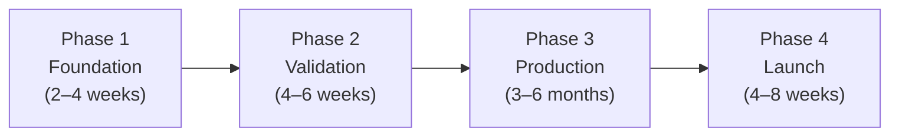

# Tumbleword — Game Scalability Analysis

> **Analyst role:** Senior game designer, game systems designer, and software architect.  
> **Date:** 2026-09-22  
> **Prototype:** [`tumbleword.html`](../tumbleword.html) — single self-contained HTML/JS file, 311 lines.  
> **Scope:** Read-only analysis. No modifications made to the project.

---

## Table of Contents

1. [Game Overview](#1-game-overview)
2. [Vertical Slice Analysis](#2-vertical-slice-analysis)
3. [Core Mechanic Analysis](#3-core-mechanic-analysis)
4. [Gameplay Loop](#4-gameplay-loop)
5. [Depth & Mastery](#5-depth--mastery)
6. [Difficulty Scalability](#6-difficulty-scalability)
7. [Content Scalability](#7-content-scalability)
8. [Mechanic Expansion](#8-mechanic-expansion)
9. [Technical Architecture Analysis](#9-technical-architecture-analysis)
10. [Production Requirements](#10-production-requirements)
11. [Competitive / Same-Mechanic Research](#11-competitive--same-mechanic-research)
12. [Biggest Risks](#12-biggest-risks)
13. [Validation Experiments](#13-validation-experiments)
14. [Development Roadmap](#14-development-roadmap)
15. [Final Assessment](#15-final-assessment)

---

## 1. Game Overview

### What is Tumbleword?

Tumbleword is a **spatial word puzzle**. The player is shown a target word (e.g. **CAT**, **SPIN**, **GLYPH**) and a square grid containing letter tiles. The grid contains walls (blocked cells) and open floor cells.

The player has exactly **two actions**: rotate the entire board **90° left** or **90° right**. After every rotation, gravity is now pointing in the new "down" direction, and every letter tile slides as far as possible in that direction — until it hits a wall, a grid edge, or another tile. The player wins when the tiles are arranged so that the target word reads **left-to-right** (relative to how the player sees the board, accounting for rotation).

### One-sentence summary

> Player rotates a maze → gravity pulls all letter tiles in the new down direction → player must plan rotations so the tiles land in the correct left-to-right order to spell the target word.

### The core puzzle question the player faces

*"If I turn left now, where will each tile end up — and will that arrangement let me reach the winning configuration in fewer future moves?"*

This is a **sequential, deterministic, reversible** puzzle with a small action space (two buttons) and a spatial reasoning core.

---

## 2. Vertical Slice Analysis

### What is included

| Feature | Present? | Notes |
|---|---|---|
| Core rotation mechanic | ✅ | Fully implemented, smooth animation |
| Gravity / settle physics | ✅ | Correct, deterministic sliding |
| Win detection | ✅ | Direction-aware (accounts for board rotation) |
| 12 handcrafted levels | ✅ | Progressing 5×5 → 7×7, 3–5 letters |
| Par / move-count scoring | ✅ | Per-level optimal move count stored |
| Undo | ✅ | Full history stack |
| Restart | ✅ | Resets to initial state |
| Level select nav | ✅ | Shows solved state persistently |
| Local-storage persistence | ✅ | Best score saved per level |
| Dark mode | ✅ | CSS custom-property based |
| Reduced-motion support | ✅ | Animation duration collapses to ~0 |
| Keyboard navigation | ✅ | Arrow keys + Z (undo) + R (restart) |
| Mobile viewport | ✅ | Responsive clamp sizing |
| Audio / sound | ❌ | Not present |
| Animations beyond rotation | ⚠️ | Cards transition; no particle/sound feedback |
| Procedural generation | ❌ | Not present |
| Achievements | ❌ | Not present |
| Hint system | ❌ | Not present |
| Difficulty rating | ❌ | Only par-move count |

### What the prototype proves

1. **The mechanic is immediately playable.** The two-button interface is self-evident; the status bar text is clear.
2. **The `settle()` function is correct.** Tiles slide in sort order relative to the gravity direction, so leading tiles don't block trailing tiles wrongly. This is non-trivial to get right and is done correctly.
3. **Win detection is rotation-aware.** `findWin()` correctly maps "left to right from the player's perspective" into grid coordinates based on current rotation state `r`. This is architecturally solid.
4. **12 levels demonstrate progression.** Grid size grows (5×5 → 7×7), word length grows (3 → 5 letters), and par-move count grows (5 → 14), showing the design space can scale along at least two axes.
5. **The undo system is functionally complete.** History stores full card state snapshots per move.
6. **Accessibility basics are covered** beyond many prototypes: ARIA labels, live region for status, reduced-motion, keyboard support.

### What remains unproven

- **Levels beyond 12.** Whether 50–200 levels can remain meaningfully distinct is not demonstrated.
- **Difficulty ceiling.** The hardest level (MAGIC, 7×7, par 14) has not been stress-tested for player frustration vs. satisfaction.
- **Replayability after solving.** The current "best score" mechanic is the only replay hook; it is untested whether players replay for optimization.
- **Session length.** No data on how long a player spends per level or per session.
- **Procedural generation suitability.** No generator or solver exists; feasibility is unproven.
- **New mechanic interactions.** Only one tile type exists; whether additional mechanics enrich or clutter is untested.

### Prototype limitations vs. design problems

| Observation | Classification |
|---|---|
| No audio | **Prototype limitation** — trivially addable |
| Only 12 levels | **Prototype limitation** — design space for more is clearly present |
| No hint system | **Prototype limitation** — not critical for validation |
| No procedural generation | **Prototype limitation** — needs separate experiment to validate |
| Only two rotation directions | **Design choice** — not a limitation; left/right is the natural identity of the mechanic |
| No "intermediate" tile feedback | **Potential design gap** — tiles disappear mid-fall; the lack of animation during slide means the player cannot "watch" gravity work (the transition is position-only) |

---

## 3. Core Mechanic Analysis

### Clarity

**Rating: Strong.**

Two buttons. One word target. One rule ("tiles slide to the new bottom"). A player can understand Tumbleword in under 30 seconds without reading instructions. The status text at the bottom reinforces this: *"Cards slide down after every turn. Line them up left to right to spell CAT."*

No tutorial levels are needed for the core — though they may help for harder levels.

### Decision Quality

**Rating: Moderate → Strong with good level design.**

At first glance there are only two actions. But the *meaningful* decision is:

1. **Which direction to turn?** (left/right)
2. **How many times?** (sequence planning)
3. **Is this a dead end that requires undoing?**

Because tiles interact with each other (they block one another mid-slide), a single rotation can produce many possible outcomes depending on wall geometry. The player must mentally simulate where **each tile** lands after every rotation. For 3-letter words on 5×5 this is tractable. For 5-letter words on 7×7 with irregular walls, multi-step planning becomes genuinely difficult.

The decision space is **non-trivial without being overwhelming** — which is the hallmark of a well-constrained puzzle mechanic.

### Depth

**Rating: Unproven → Strong potential.**

The prototype shows two clear depth dimensions:

1. **Wall geometry as a constraint.** Walls force tiles to stop early, creating asymmetric outcomes for left vs. right rotations. The same rotation can have very different effects depending on which tiles are adjacent to which walls.
2. **Tile interaction (blocking).** A tile stopped by a wall becomes an obstacle for another tile arriving behind it. This creates chain dependencies — you may need to move tile B to unblock the path for tile A.

Whether this depth holds over 50–200 levels depends on whether new wall configurations can keep producing genuinely new problems. **This is the central unproven claim** (see Section 12).

### Mastery

**Rating: Moderate.**

A skilled player learns:
- How walls create "rails" that consistently route a tile
- Which rotations preserve relative ordering of tiles vs. which scramble it
- How to route tiles to their final positions in parallel (optimizing for par)

These are learnable spatial insights that transfer across levels. This is stronger than "memorize the answer" (i.e., real mastery) but whether the mastery curve sustains engagement over 50+ levels is **unproven**.

### Discovery ("Aha" moments)

**Rating: Strong.**

The mechanic naturally produces aha moments:
- "Oh — if I turn right twice, C falls into this column and then slides left into position."
- "These two tiles are blocking each other. I need a 'detour' rotation to separate them first."

The par-move system amplifies this: solving in fewer moves than par requires the player to find non-obvious optimal paths.

### Failure

**Rating: Strong.**

Failure is always the player's own: every rotation is deterministic and the player chose it. There is no randomness. The Undo button ensures failure is never punishing — the player can rewind and try a different approach. Restart is one button away.

Failure is instructive, not punitive. This is excellent puzzle design.

### Replayability

**Rating: Weak in current form.**

Currently the only replay motivation is:
- Reaching par (fewest moves)
- Revisiting skipped levels

There is no procedural generation, no daily challenge, no randomization, and no meta-progression. After all 12 levels are solved at par, there is nothing left to do. This is a **prototype limitation**, not a design flaw — the mechanic itself supports replay motivation (par chasing), but the surrounding structure to sustain replayability does not yet exist.

### Variety

**Rating: Moderate → Unproven at scale.**

Current variety levers used:
- Grid size (5×5 → 7×7)
- Word length (3 → 5)
- Wall pattern (each level unique)
- Initial tile placement

These four levers together produce meaningfully different puzzles across the current 12 levels. Whether they sustain variety to 100+ levels without the addition of new game elements is **unproven**.

### Difficulty Scaling

**Rating: Moderate → See Section 6 for full analysis.**

### Player Agency

**Rating: Strong.**

Every outcome is the player's direct consequence. Undo means mistakes are forgivable. No randomness. The player is always in control.

---

## 4. Gameplay Loop

```
Load level
  │
  ▼
See target word + initial tile positions
  │
  ▼
Mentally simulate: "Where do tiles land if I rotate left? Right?"
  │
  ▼
Choose rotation direction → board rotates → tiles settle
  │
  ▼
Observe new positions → update mental model → repeat
  │
  ▼
Win condition met? ──YES──▶ Show result + move count vs. par
  │                              │
  NO                      Replay for par? ──▶ Restart
  │
  ▼
Undo / restart / continue
```

**Loop assessment:** Clean, low-friction, self-contained. Each move is a "think, act, observe" cycle — the ideal puzzle loop. No forced waiting, no resource management, no extraneous systems.

The loop does **not** currently have a meta-layer (world map, story, unlocks, etc.). This is a prototype limitation.

---

## 5. Depth & Mastery

### Current depth mechanisms (confirmed in prototype)

1. **Wall topology as puzzle constraint.** Different wall patterns create qualitatively different "routing problems." A wall in the center forces tiles to stop early; a wall in the corner creates an L-shaped buffer zone.

2. **Tile mutual blocking.** Two tiles in the same row/column can block each other's movement. The player must sequence rotations to separate them, then re-converge.

3. **Word ordering constraint.** The word must read left-to-right from the player's visual perspective. Because the board rotates, the player must track not only where tiles are but what "left" means in the current orientation.

4. **Par optimization as a mastery layer.** Solving a level is the floor; solving at par (fewest possible moves) requires finding the optimal sequence. This is a genuine additional challenge that rewards mastery.

### Missing depth mechanisms (not yet implemented)

These are design opportunities, not deficiencies in the prototype:
- Multiple tile types (see Section 8)
- Rotation-locked tiles
- Multi-word targets
- Sequential reveal (tiles enter mid-puzzle)

### Mastery cliff

The current 12-level progression does not demonstrate whether the game can maintain a **gradual mastery curve** over 50–200 levels. At level 12 (MAGIC, par 14), the puzzle is already reasonably complex. Sustaining that curve requires either:

a) More elaborate wall patterns  
b) New mechanics (introduced carefully)  
c) Both

Whether wall patterns alone can sustain 200 levels of meaningful depth is **unproven**.

---

## 6. Difficulty Scalability

### Confirmed scaling levers (currently used)

| Lever | Effect | Risk of saturation |
|---|---|---|
| Grid size (n×n) | More cells = more possible wall patterns + longer slide distances | Low — 7×7 barely reached; 10×10 is plausible |
| Word length | More tiles = more interactions to coordinate | Moderate — 6–7 letter words may be very hard; 8+ likely frustrating |
| Wall density | More walls = more constrained routing | Can become frustrating if over-used |
| Initial tile positions | Tiles far apart = more routing required | Works well but can feel arbitrary at extremes |

### Meaningfully difficult scaling (positive)

- Walls that create "one-way" routes (tile can enter a pocket but can't leave without another rotation)
- Walls that require tiles to be sequenced precisely (A must move before B can move)
- Word length 5+ where the letter ordering creates inter-tile dependencies

### Quantitatively difficult scaling (negative — avoid)

- Simply making the grid larger without changing wall structure
- Adding more letters that are irrelevant to the target word (noise tiles)
- Increasing par without increasing genuine complexity

### Scaling verdict

The prototype demonstrates **two or three genuine difficulty levers** that don't degrade into quantity-over-quality. However, the absence of any mechanic beyond walls and tiles means that at some point (estimated: ~40–60 levels), wall geometry variation alone will start feeling like the same puzzle in a new costume.

---

## 7. Content Scalability

### Handcrafted levels

**Viability: High for 50 levels, Uncertain for 200+.**

The current 12 levels are handcrafted and clearly authored with intentionality — par values are set per-level, walls are non-trivial. A skilled puzzle designer could likely produce 50 quality levels. Beyond that, without new mechanics or procedural tools, quality control becomes expensive.

**Key requirement: A solver.** Without a solver, the designer cannot verify whether a level is solvable, what the optimal move count is, or whether the level has unintended shortcuts. The prototype hardcodes `best` values, which appear manually set. This will not scale beyond ~20 levels without automation.

### Procedural generation

**Viability: Moderate — appropriate as a tool, not as the primary mode.**

The mechanic is **solver-friendly**:
- State space: `(card positions) × (board rotation)` — finite and enumerable
- A BFS/A\* search from any initial state can find the optimal solution path
- A generator can randomly place walls and tiles, verify solvability + par, and discard invalid configurations

**Where procedural generation helps:**
- Daily challenge mode (one fresh puzzle per day, solver-verified)
- Generating candidate levels for a human designer to curate
- Endless mode (lower quality bar acceptable)

**Where procedural generation hurts:**
- Replacing handcrafted levels — random levels tend to lack the intentional "aha" moment that good puzzle design creates
- Generating tutorial-appropriate levels is hard randomly

### Solver-generated levels (recommended)

A BFS/iterative-deepening solver operating on the `settle()` function (which is already clean and pure) could:
1. Verify any given level is solvable
2. Compute true optimal par
3. Be used in a generator: random config → solver → accept if par is in desired range → human review

This is the most valuable technical investment after the prototype, and it is **directly enabled by the current architecture** (the `settle()` and `findWin()` functions are pure and side-effect free).

### Daily challenge / streaks

**Viability: High.** The mechanic suits daily puzzles well (one word per day, shared with all players, short session). This is a proven model (Wordle, NYT Games, etc.) and fits Tumbleword's 2–5 minute session profile.

### Endless mode

**Viability: Moderate.** A solver-backed random generator could produce infinite levels of a given difficulty band. Engagement would be lower than handcrafted levels but serves a "keep playing after finishing campaign" purpose.

---

## 8. Mechanic Expansion

### Core mechanic — DO NOT CHANGE

> Rotate the board 90° left or right → gravity pulls all tiles to the new bottom → spell the target word left-to-right.

This is clean, elegant, and non-negotiable. Any expansion must preserve this identity.

---

### Natural extensions (emerge from the core rule)

| Extension | Why it's natural | Risk |
|---|---|---|
| **Fixed tiles** (pinned to a cell, don't slide) | Players must route other tiles around fixed anchors | Low — same mechanic, new constraint |
| **Heavy tiles** (slide through other tiles?) | Breaks tile-blocking interaction; probably too complex | Medium |
| **Paired tiles** (two tiles that are always adjacent) | Must be positioned together; spatial constraint | Low |
| **Multi-word targets** (two words in one puzzle) | More coordination required, same mechanic | Low — good for late-game levels |
| **One-way walls** (tiles can slide past in one direction only) | Directional routing constraint | Medium — adds an explanation cost |
| **Par-exclusive scoring** (3-star system) | Reward tiers for move count; purely systemic | Very low — pure content |

---

### Dangerous extensions (add complexity, not depth)

| Extension | Why it's dangerous |
|---|---|
| **Timer / time pressure** | Changes the genre from puzzle to reflex; alienates the player base |
| **Random tile spawning** | Introduces randomness into a deterministic game; destroys the "fair failure" property |
| **Rotating tiles individually** | Adds a third action; dilutes the elegance of the two-button design |
| **Enemies / hazards that move** | Turns a spatial word puzzle into a spatial action game |
| **Energy / lives system** | Artificially gates a puzzle game; terrible UX for a mechanic built on exploration and undo |
| **In-puzzle hints** | Only dangerous if they remove the puzzle; a post-completion hint is fine |

---

### Possible late-game mechanics

These are appropriate only after the player has mastered the base mechanic (~levels 30–50):

1. **Locked tiles** — One or more tiles are locked in place and cannot slide until a specific prior condition is met (e.g., another tile lands adjacent). This creates a sequencing constraint.
2. **Conveyor walls** — A wall that, when a tile hits it, immediately re-slides the tile in an orthogonal direction. Creates routing chains.
3. **Wrap-around edges** — Tiles that slide off one edge reappear on the opposite edge. Fundamentally changes routing logic in a brain-bending way.
4. **Multi-word with shared tiles** — Two target words that share a letter tile in the solution. Forces players to satisfy two constraints simultaneously.

> [!WARNING]
> Introduce at most **one** new mechanic per "world" or "chapter." Each mechanic must be introduced with a dedicated tutorial level that demonstrates it without other complications.

---

## 9. Technical Architecture Analysis

### Classification: **Needs Refactoring** (before production, not before further prototyping)

The prototype is a single 311-line HTML file. This is appropriate for a prototype. The code quality within those 311 lines is, however, notably good — better than average for a prototype.

### Strengths

| Aspect | Assessment |
|---|---|
| **Core logic purity** | `settle()` and `findWin()` are pure functions with no side effects. They take state in, return state out. This is the most important architectural decision in the game — it enables undo, solver, testing, and future procedural generation. |
| **State object** | Game state is captured in a single `S` object (`r`, `angle`, `cards`, `hist`, `moves`, `locked`, `won`). This is clean and serializable. |
| **Level data format** | Levels are plain JSON objects: `{word, n, walls[], cards[], best}`. This is excellent — levels can be authored in a text editor, validated with a schema, or generated programmatically. |
| **Separation of physics from rendering** | `settle()` computes the new card positions; `render()` applies them to the DOM. These are separate functions. |
| **Accessibility** | ARIA labels, `aria-live`, reduced-motion, keyboard support — all present at prototype stage. |
| **Persistence** | localStorage is wrapped in try/catch, guarded against malformed JSON. |

### Weaknesses

| Aspect | Assessment |
|---|---|
| **Everything in one file** | HTML, CSS, JS, and level data are co-located. Manageable for 12 levels; unmanageable for 200 levels. |
| **Global state** | `L`, `S`, `cardEls`, `solved` are module-level globals. Fine for prototype; fragile for a larger codebase. |
| **Level data embedded in script** | `LEVELS` is a hardcoded array literal. Adding levels requires editing the source file. There is no content pipeline. |
| **No module system** | All code is in a `<script>` tag. No ES modules, no imports, no tree shaking. |
| **No test coverage** | `settle()` and `findWin()` are pure and easily unit-testable. No tests exist. |
| **Animation coupling** | `LOCK_MS` (800ms) ties rotation animation duration to game logic. The `locked` flag prevents player input during animation — which is correct — but the timing is hardcoded. |
| **Render uses DOM string positions** | Cards are positioned by `style.left` / `style.top` percent strings. Functional but brittle; a canvas or grid-based layout would scale better for effects/animation. |
| **No solver** | As noted in Section 7, the `best` (par) values are manually authored. A solver is needed before scaling level production. |

### Refactoring priorities (before production)

1. **Extract level data to JSON files** — separate content from code.
2. **Convert to ES modules** — separate game logic, rendering, persistence, and UI.
3. **Write unit tests for `settle()` and `findWin()`** — these are the load-bearing pure functions.
4. **Build a solver** — BFS on `(cards[], r)` state using `settle()` and `findWin()`. Required for level verification and procedural generation.
5. **Content pipeline** — a level editor or at minimum a level validation script.

### Can the prototype evolve into a production codebase?

**Yes, with planned refactoring.** The core logic (settle, findWin, state model, level format) is well-designed and would survive a refactor into a proper module architecture. The DOM rendering layer would likely be rewritten (Canvas/WebGL or a proper component framework) but is not load-bearing for game logic.

---

## 10. Production Requirements

### Required for the game to work correctly

| Item | Current State | Priority |
|---|---|---|
| Solver / level verifier | Missing | **Critical** |
| Level content pipeline | Missing (embed only) | **Critical** |
| More levels (target: 50 minimum) | 12 present | **Critical** |
| Save / progression system | Basic (localStorage best scores) | **Needs expansion** |
| Difficulty labeling per level | Missing | **High** |

### Required for a good player experience

| Item | Current State | Priority |
|---|---|---|
| Audio (rotation click, win jingle, tile land sound) | Missing | **High** |
| Tile slide animation (show tiles moving) | Missing — only start/end positions animate | **High** |
| Hint system (show one step, costs moves) | Missing | **High** |
| Level completion summary (stars, score) | Minimal | **High** |
| Meta-progression (world map, chapter unlocks) | Missing | **High** |
| Daily challenge mode | Missing | **Medium** |
| Settings (volume, theme toggle exposed) | Dark mode auto-only | **Medium** |

### Polish (valuable but not blocking)

| Item | Notes |
|---|---|
| Haptic feedback (mobile) | Navigator.vibrate API — easy |
| Share result card (e.g., emoji grid) | Wordle-style social sharing |
| Leaderboards | For daily challenge mode |
| Achievement system | "Solved at par", "No undos", etc. |
| Onboarding animation | Optional; mechanic is clear enough |
| App store packaging (PWA or native) | Required for mobile distribution |

### Optional features (do not build without validation)

| Item | Notes |
|---|---|
| Procedural endless mode | Build only if solver is validated |
| Level editor | Valuable for content production, not for players |
| Multiplayer / race mode | Different game; assess separately |
| Narrative / theme | Could add charm; not mechanically necessary |

---

## 11. Competitive / Same-Mechanic Research

> [!NOTE]
> All competitor information below is based on web research conducted during this analysis. It reflects publicly available information as of September 2026 and should be independently verified before making business decisions.

### Closest competitors found

#### Gravity Station (iOS / Android — published)

- **Mechanic overlap:** Core mechanic is identical — rotate the entire chamber (90°), all loose objects slide until hitting a wall or another object.
- **Differences:** Gravity Station uses non-letter objects (puzzle pieces, not letters). The goal is spatial arrangement, not word formation. It features lasers, portals, and wormholes as late-game mechanics. 1,000 campaign stages, daily mode, hardcore mode.
- **Significance:** This is the most direct mechanical predecessor to Tumbleword. It proves the rotation-gravity-slide mechanic is commercially viable and can sustain 1,000 levels. It does **not** use the word-spelling overlay.

#### Loophole / Gravity Word (web, Wordle-adjacent daily puzzle)

- **Mechanic overlap:** Flip gravity in four directions, letter tiles slide, words form.
- **Differences:** Tiles are anonymous letter tiles, not specific named tiles spelling a specific target word. The goal is to clear word-shaped rows/columns from a large board for points — more of a score-attack than a pure puzzle. Four gravity directions vs. Tumbleword's two rotations.
- **Significance:** Proves there is appetite for gravity + word hybrid games, but the design space is meaningfully different.

#### "Rotate" (browser classic, Evan Miller / multiple clones)

- **Mechanic overlap:** Rotate the entire level to change gravity for a character/ball.
- **Differences:** Platformer, not puzzle. Marble/character navigates, not tiles. No word mechanic.

### What Tumbleword does differently

| Dimension | Tumbleword | Gravity Station | Gravity Word |
|---|---|---|---|
| Semantic goal (spell a word) | ✅ | ❌ | Partial |
| Exact-word target | ✅ | ❌ | ❌ |
| Left-right reading order as win condition | ✅ | ❌ | ❌ |
| Two rotation directions (left/right only) | ✅ | ❌ (4 dirs) | ❌ (4 dirs) |
| Letter tiles with identities | ✅ | ❌ | Partial |
| Par/optimal move scoring | ✅ | Unknown | ❌ |

### Is the difference meaningful?

**Yes.** The word-spelling constraint fundamentally changes the puzzle structure:

1. **Ordering matters.** In Gravity Station, tiles are interchangeable objects. In Tumbleword, tile C must be to the left of tile A, which must be left of T. This creates an **ordering constraint on top of a positioning constraint**, which is a qualitatively different and harder puzzle.

2. **The target word creates instant emotional resonance.** "I need to spell GLYPH" is more engaging than "I need to move object into slot." The word is the theme, the challenge, and the feedback all at once.

3. **Two-direction rotation is more constrained and thus more interesting.** You cannot undo a rotation directly (rotating left twice is different from rotating right twice). This constraint increases planning depth compared to four-direction designs.

### Differentiation verdict

Tumbleword occupies a **distinct design niche** that neither Gravity Station nor Gravity Word fills. The combination of (rotation physics) + (word-spelling with ordering constraint) + (two-direction constraint) is not directly replicated by any confirmed existing product found in this research.

---

## 12. Biggest Risks

### Risk 1 — PRIMARY: Wall geometry alone cannot sustain 100+ levels of meaningful variety

**Evidence from prototype:**  
The 12 current levels vary wall patterns extensively, but by level 8–12 the structural challenge is already "complex wall routing + letter sequencing." The game has only one mechanic dimension: rotation. Every level variation must emerge from wall placement and tile placement. There is no confirmed evidence that this design space is large enough for 200 meaningful levels without introducing new game elements.

**Why this is the biggest risk:**  
Gravity Station required portals, lasers, and wormholes to sustain 1,000 levels. Tumbleword's word constraint provides one additional dimension Gravity Station lacks, but it may not be enough on its own.

**Mitigation:**  
Experiment: build 30 more levels using only current mechanics. If levels 30–40 feel like recycled versions of earlier levels, the base mechanic needs a new dimension. If they feel fresh, the concern is reduced.

---

### Risk 2 — Difficulty ceiling and player frustration

**Evidence from prototype:**  
The prototype offers undo and restart but no hints. At par 14 (level 12, MAGIC on a 7×7 with 5 tiles and irregular walls), the puzzle is already genuinely difficult. If future levels reach par 20+, players without spatial reasoning ability will hit a wall (no pun intended) and quit. The difficulty curve after level 12 is completely uncharted.

**Mitigation:** A hint system (show one correct move, costs +2 moves) and star ratings (3 stars = at par, 1 star = solved at all) would allow the difficulty to scale without excluding casual players.

---

### Risk 3 — No replay hook beyond par-chasing

**Evidence from prototype:**  
Once all levels are solved at par, there is nothing left. The prototype has no daily mode, no endless mode, no social sharing, no meta-progression. Par-chasing alone retains only a subset of players.

**Mitigation:** Daily challenge mode is the highest-value addition (low cost, high retention).

---

### Risk 4 — Solver absence blocks level production

**Evidence from prototype:**  
The 12 `best` (par) values in `LEVELS` are manually authored. There is no way to verify them programmatically. As level count grows, manual verification becomes error-prone and slow. A miscalculated par that says 8 when the true minimum is 6 will frustrate players achieving 7 moves and seeing "The fewest possible is 8."

**Mitigation:** Build the solver before producing more than 5–10 additional levels.

---

## 13. Validation Experiments

### Experiment 1 — Highest priority: Build 20 more handcrafted levels

**Goal:** Determine whether wall-geometry variation alone can sustain meaningful variety to level 30.  
**Success criterion:** At least 15 of the 20 new levels feel qualitatively different from each other and from the first 12.  
**Failure criterion:** Levels 20–30 feel like harder versions of the same puzzle pattern.  
**Estimated cost:** 1–2 weeks for a skilled puzzle designer with a solver available.

**This is the smallest experiment that directly tests the biggest risk.**

---

### Experiment 2 — Build a BFS solver

**Goal:** Verify par values, enable level design automation, and lay groundwork for procedural generation and daily challenges.  
**Implementation:** BFS on `(cards[], r)` state using the existing pure `settle()` and `findWin()` functions. State space is bounded: `n×n` positions per tile, 4 rotations, combinatorially manageable for grids up to 8×8.  
**Estimated cost:** 1–3 days of engineering.

**This unblocks level production immediately.**

---

### Experiment 3 — Test with 5 players (difficulty curve)

**Goal:** Find where the current difficulty curve breaks.  
**Method:** Observe 5 players (ideally without puzzle-game backgrounds) play levels 1–12. Note where they first use undo, where they restart, where they quit.  
**Estimated cost:** Half a day + participant recruitment.

---

### Experiment 4 — Introduce one new mechanic in a 3-level mini-sequence

**Goal:** Test whether a new element (e.g., fixed/pinned tiles) adds depth without confusion.  
**Method:** Design 3 levels: one introduces the mechanic in isolation, one combines it with basic walls, one combines it with complex walls.  
**Success criterion:** Players complete all three without feeling confused about the new rule.  
**Estimated cost:** 2–3 days of design + build.

---

### Experiment 5 — Daily challenge prototype

**Goal:** Test whether a one-puzzle-per-day format creates retention motivation.  
**Method:** Release a version with a single solver-verified daily puzzle (no campaign) to a small audience. Track return rate day 2 and day 7.  
**Estimated cost:** 1 week engineering (requires solver).

---

## 14. Development Roadmap

> [!IMPORTANT]
> This roadmap is conditioned on the results of the validation experiments. Do not proceed to Phase 3 without completing Phase 2 experiments.



### Phase 1 — Foundation (2–4 weeks)

- Build BFS solver (verify existing par values; they may contain errors)
- Extract level data to JSON; separate JS modules
- Add tile-slide animation (show tiles moving during gravity, not just start/end)
- Add audio: rotation click, tile land, win jingle

### Phase 2 — Validation (4–6 weeks)

- Design levels 13–32 using solver for verification
- Run player testing (5–10 players) on levels 1–32
- Evaluate: are levels 20–32 meaningfully distinct?
- Build and test one new mechanic (fixed tiles recommended)
- Build daily challenge prototype with solver-backed generation

**Decision gate:** If levels are repetitive by level 25, design requires a new mechanic before Phase 3.

### Phase 3 — Production (3–6 months)

- Complete 50–100 handcrafted levels (solver-verified)
- Implement meta-progression (chapters/worlds, level unlock)
- Hint system (costs +2 moves)
- Star rating per level (1/2/3 stars based on move count vs. par)
- Daily challenge mode with server-side calendar
- Social sharing (emoji-grid result cards)
- Settings: sound toggle, theme toggle, accessibility options
- PWA or native app wrapping

### Phase 4 — Launch (4–8 weeks)

- App store submission (iOS/Android PWA or native)
- Analytics integration (level completion rates, undo frequency, quit points)
- Soft launch / limited release
- Iterate on difficulty curve based on analytics
- Full launch

---

## 15. Final Assessment

### Core Mechanic

**Strong.**

The rotation-gravity-slide mechanic is deterministic, reversible, immediately comprehensible, and produces genuine spatial reasoning challenges. The addition of the word-spelling constraint (including the left-to-right ordering requirement) creates a qualitatively distinct puzzle space from existing rotation-gravity games. The mechanic demonstrates clarity, player agency, fair failure, and natural aha moments — all within 12 levels and a two-button interface. The pure functional design of `settle()` and `findWin()` is an architectural asset.

### Content Scalability

**Unproven.**

Wall-geometry variation has sustained 12 meaningfully distinct levels. Whether it sustains 50–200 levels without new mechanics is the central unresolved question. The design space is large enough that this may be possible, but there is no evidence for it yet. The word-ordering constraint provides one additional content dimension that Gravity Station lacked, which is encouraging. A solver and 20 more levels will largely answer this question.

### Technical Scalability

**Needs Refactoring.**

The core logic (`settle()`, `findWin()`, the state model, the level data format) is well-architected and production-ready in principle. The surrounding structure (single-file, global state, no tests, no content pipeline, no solver) is prototype-appropriate but will block production-scale development if not addressed. The refactoring required is straightforward and well-scoped — this is not an architectural redesign.

### Replayability

**Weak (currently) → Unproven at scale.**

Par-chasing provides a replay hook, but it retains only a subset of players. The mechanic is well-suited to daily challenges (short sessions, single word, shareable result), which is the highest-value replay addition. Without daily challenges or meta-progression, replayability after campaign completion is low. This is a prototype limitation, not a design flaw.

### Production Feasibility

**Moderate → High (conditional).**

The core is clean and the mechanic is proven at prototype scale. Production feasibility is moderate because the most critical open questions (level variety at scale, difficulty curve, player retention) are unresolved. If validation experiments confirm that 30 levels feel distinct and players complete the prototype without frustration, production feasibility upgrades to high. The technical effort required is well-scoped for a small team or solo developer.

### Biggest Risk

**Wall geometry alone cannot sustain 100+ levels of meaningful variety without the introduction of at least one new mechanic element.**

Evidence: 12 levels exhaust the simplest 5×5 configurations and are already mid-complexity on 7×7. Gravity Station — the closest mechanical predecessor — required portals, lasers, and wormholes to reach 1,000 levels. Tumbleword's word-ordering constraint provides a meaningful additional dimension, but it is not confirmed to be sufficient on its own.

### Recommended Next Experiment

**Build a BFS solver (3 days) + design and add levels 13–32 (1–2 weeks).**

The solver enables: par verification, level validation, and future procedural generation. The 20 new levels directly test the biggest risk. Together they answer the question: *"Does this mechanic have 50 levels of depth, or only 20?"* — which is the most important decision gate before committing to production.

---

## Final Recommendation

### ✅ PROCEED WITH VALIDATION

**Tumbleword has a strong, elegant, differentiated core mechanic.** The rotation-gravity-slide puzzle with a word-spelling constraint occupies a genuinely distinct design niche that is not directly replicated by confirmed existing products. The prototype demonstrates clarity, fair failure, player agency, and natural depth across 12 levels. The technical implementation is better-structured than average for a prototype — particularly the pure-function physics core, which is an architectural asset.

**The mechanic justifies continued development.** However, one critical uncertainty must be tested before committing to production:

> **Does wall-geometry variation alone sustain meaningful level variety to 50+ levels, or does the game require a new mechanic element by level ~25?**

**The required experiment** is small: build a BFS solver (3 days), use it to design and verify 20 more levels (1–2 weeks), and play-test them. The answer will determine whether the game goes to production as-is or requires one carefully chosen mechanic addition first.

**Do not build audio, UI polish, or meta-progression before this experiment is complete.** The experiment costs ~2–3 weeks and either confirms a credible path to 100 levels or identifies the exact design gap that must be filled.

If levels 13–32 feel meaningfully distinct and players complete them with appropriate friction (using undo/restart but not quitting), the credible path from this vertical slice to a complete, interesting, scalable game exists. Proceed to production.

---

*Analysis based on direct inspection of [`tumbleword.html`](../tumbleword.html) (311 lines, 16,396 bytes) and competitive web research conducted 2026-09-22.*
