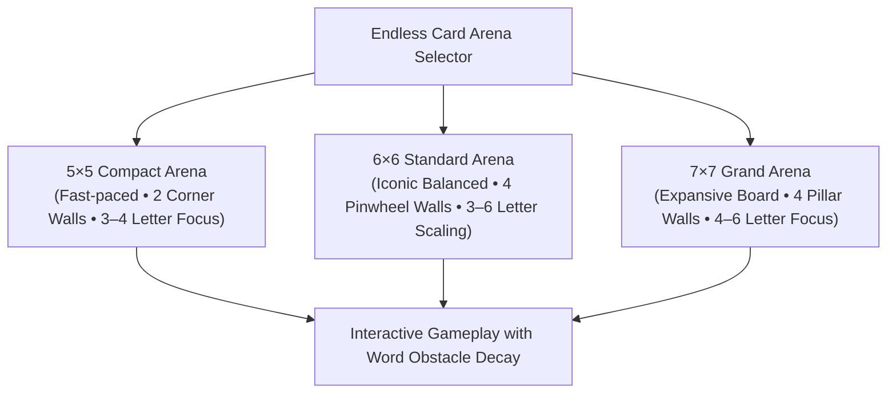

# Implementation Plan: 3 Endless Arena Variations with Fixed Walls

## 1. Overview & Objective
Replace the randomized wall generation in Endless Arcade with **3 distinct, handcrafted Arena Variations** ($5 \times 5$ Compact, $6 \times 6$ Standard, and $7 \times 7$ Grand). Each arena size features a **permanent, fixed iconic wall layout** that remains consistent on every run, allowing players to master spatial gravity strategies while enjoying infinite non-repeating word sequences.



---

## 2. Arena Layout Specifications

### Arena 1: 5×5 Compact ("Novice / Speed Arena")
- **Grid Dimension**: $N = 5$
- **Fixed Wall Layout**:
  ```text
  . . . . .
  . . . . .
  # . . . .
  . . . . .
  . . . . #
  ```
- **Gameplay Characteristic**: Tight, fast gravity routing. Perfect for quick sessions and 3-to-4 letter words.

---

### Arena 2: 6×6 Standard ("Pro / Classic Arena")
- **Grid Dimension**: $N = 6$
- **Fixed Wall Layout**:
  ```text
  . # . . . .
  . . . . # .
  . . . . . .
  . . . . . .
  . # . . . .
  . . . . # .
  ```
- **Gameplay Characteristic**: Balanced symmetrical pinwheel bumpers. Ample room for multi-tile obstacles and full 3-to-6 letter progression.

---

### Arena 3: 7×7 Grand ("Master Arena")
- **Grid Dimension**: $N = 7$
- **Fixed Wall Layout**:
  ```text
  . . . . . . .
  . . # . . . .
  . . . . . # .
  . . . . . . .
  . # . . . . .
  . . . . # . .
  . . . . . . .
  ```
- **Gameplay Characteristic**: Expansive board with interior pillar bumpers. Accommodates 3 to 4 concurrent multi-word obstacles and complex cascading combos.

---

## 3. UI & UX Architecture

### Home Screen Endless Card
- Add a 3-segment arena selector pill group directly on the Endless Card:
  `[ 5×5 Compact ]` `[ 6×6 Standard ]` `[ 7×7 Grand ]`
- Active selection is highlighted in vivid purple theme.
- The `BEST: X` badge dynamically updates to reflect the player's personal high score for the selected arena size.
- Selected arena preference is remembered in `localStorage` (`tumbleword_endless_arena_pref`).

### Storage & High Scores
- Separate persistent best streak keys:
  - `tumbleword_endless_best_5`
  - `tumbleword_endless_best_6`
  - `tumbleword_endless_best_7`
- The Achievements & Stats modal aggregates and displays all 3 arena bests.

### Editor Mode Benchmark Tool
- Add a Grid Size selector dropdown/segmented button (`5×5`, `6×6`, `7×7`) in the Endless Seed Benchmark panel so developers can benchmark and timeline-scrub runs across all 3 arena sizes.

---

## 4. Implementation Steps

1. **[`src/data/endlessWalls.js`](file:///E:/PROTO/TUMBLEWORD/src/data/endlessWalls.js)**:
   - Define `ARENA_CONFIGS` with fixed wall templates, names, and dimension $N$ for sizes `5`, `6`, and `7`.
   - Export `getArenaConfig(gridSize)`.

2. **[`src/data/wordDictionary.js`](file:///E:/PROTO/TUMBLEWORD/src/data/wordDictionary.js)**:
   - Update `WordDeck.getNextWord(streakIdx, gridSize)` to calibrate word length progression tailored to the arena size (e.g. 5x5 stays within 3–4 letters longer; 7x7 quickly reaches 5–6 letters).

3. **[`src/core/GameState.js`](file:///E:/PROTO/TUMBLEWORD/src/core/GameState.js) & [`src/core/GameEngine.js`](file:///E:/PROTO/TUMBLEWORD/src/core/GameEngine.js)**:
   - Support `startEndlessMode(seed, gridSize = 6)`.
   - Save high scores to the respective arena key upon achieving a new personal best.

4. **[`index.html`](file:///E:/PROTO/TUMBLEWORD/index.html) & [`styles/main.css`](file:///E:/PROTO/TUMBLEWORD/styles/main.css)**:
   - Add the Arena selector segmented controls to the Endless Card and Editor Benchmark panel.
   - Style active arena chips with glowing purple accent states.

5. **[`src/simulation/endlessSimulator.js`](file:///E:/PROTO/TUMBLEWORD/src/simulation/endlessSimulator.js)**:
   - Update `simulateEndlessSeed(seed, maxWords, gridSize)` and `buildEndlessTimelineSnapshots` to simulate on the selected arena geometry.

6. **Verification & Testing**:
   - Run batch BFS simulations across seeds 1–25 for all 3 arena variations ($5\times 5$, $6\times 6$, $7\times 7$) to verify 100% solvability.
   - Rebuild all distribution targets (`web`, `itch`, `editor`, and `playstore`).
